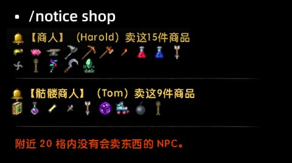
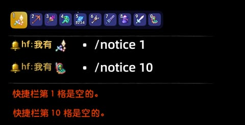

# TShockNotice

TShock 播报插件。

下载地址：[Notice-v0.2.0-1116.dll](https://github.com/hufang360/TShockNotice/releases/download/v0.2.0/Notice-v0.2.0-1116.dll)

## 功能

- 旅商出现时，全服自动播报旅商当前库存。
- 刷新任务鱼时，全服自动播报今天的渔夫任务鱼。播报条件：渔夫在场且非无家可归。当天已播报过之后上线的玩家会收到补发。
- BOSS 被击败时，播报伤害贡献与 BOSS 战期间各玩家的死亡次数，可用 `/notice boss` 重播。





## 指令

```text
/notice shop     播报附近 NPC商店 库存，旅商、骷髅商人、普通城镇 NPC 都支持。
/notice fish     播报今天的渔夫任务鱼
/notice boss     再次播报最近一场 BOSS 战报
/notice 1~10     播报自己快捷栏第 1~10 格的物品
```

`/notice` 可以简写成 `/n`。

## 权限

- `hf.notice.use`

## 构建

```bash
dotnet build Notice/Notice.csproj -c Release
```

依赖 NuGet `TShock` 6.2.1，目标框架 `net9.0`。
